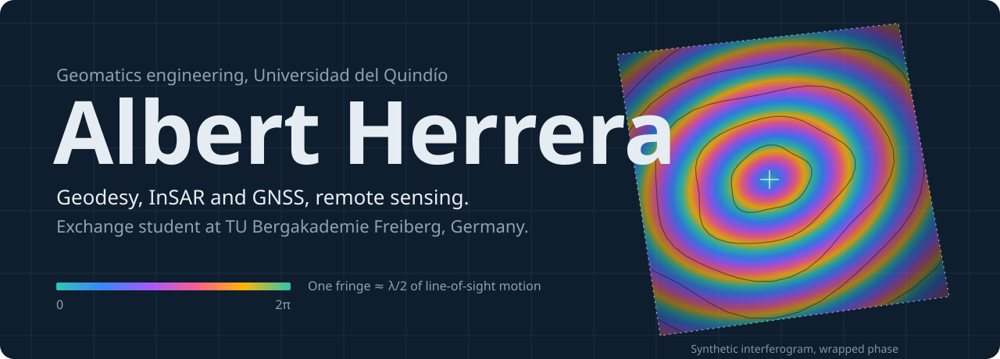
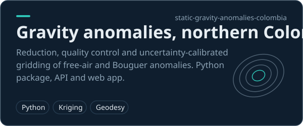
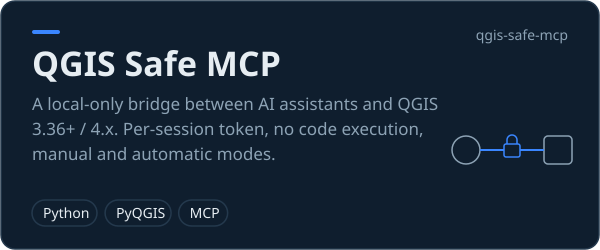
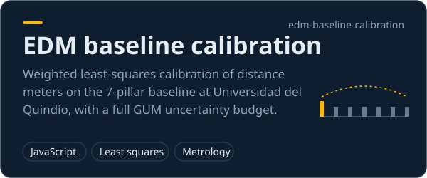
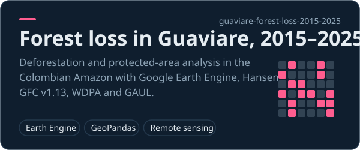
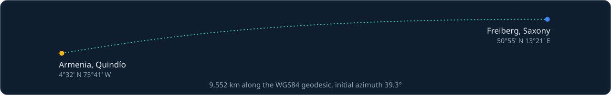

I'm a Topographic and Geomatics Engineering student at Universidad del Quindío (Colombia), currently on a KOSPIE exchange at TU Bergakademie Freiberg. I work where geodesy meets data: least-squares adjustment with honest uncertainty budgets, gravity-field reduction, and Earth observation pipelines that someone else can rerun. Long term, I'm heading toward quantitative InSAR–GNSS integration.

**Right now**

- Taking Applied Remote Sensing at TU Bergakademie Freiberg
- Waiting on peer review for a paper on static gravity anomalies in northern Colombia
- Maintaining QGIS Safe MCP, an open-source bridge between AI assistants and QGIS
- Teaching assistant in Metrology and member of the GEOIDE research group (Minciencias)

### Selected work

<table>
  <tr>
    <td width="50%"></td>
    <td width="50%"></td>
  </tr>
  <tr>
    <td width="50%"></td>
    <td width="50%"></td>
  </tr>
</table>

### Toolbox

**Geodesy and adjustment** — weighted least squares, GUM uncertainty budgets, gravity reduction (FAA, Bouguer) 
**Remote sensing** — Google Earth Engine, Hansen GFC, land-change modelling (CA-Markov), RUSLE 
**GIS and photogrammetry** — QGIS / PyQGIS, PostGIS, GeoPackage, Agisoft Metashape, PHOTOMOD, Civil 3D

  
  
  
  
  
  

### Find me

